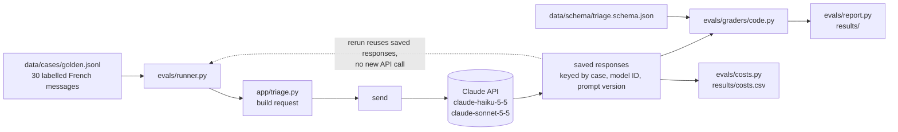
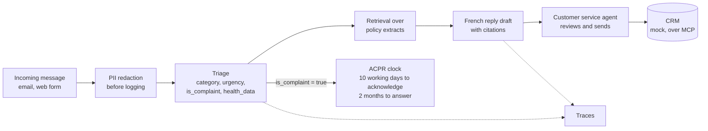

# Architecture

!!! warning "Design, not yet built or run."
    Both diagrams show the intended design. The phase 0 parts are being built. The target design is what later phases add, and it can change as the evals report back.

## Phase 0: triage and its eval harness

The design choices behind it, each with the alternative that lost:

| Choice | Rejected alternative | Why |
|---|---|---|
| Save every response with its usage, and grade offline from the saved copy | Call the API again on every grading run | Grading code changes far more often than prompts do. Saved responses make a grader fix free and keep the cost ledger honest |
| Building the request is separate from sending it | One function that builds and sends | The Batch API (half price) takes the same request bodies. Phase 1 adds a Batch path without touching the triage logic |
| JSON schema in `output_config.format` | Forced tool use with a strict tool | Triage needs no tool, and forced `tool_choice` returns a 400 on Sonnet 5.5 |
| Model ID, `max_tokens` and thinking setting in configuration, recorded in every results file | Hard-coded per call | Haiku 5.5 can turn thinking off and Sonnet 5.5 can't, so the setting is per model and must be visible next to each result |
| Tests run through a stub client that returns canned usage | Tests that call the API | CI never needs a key and never spends money |

## Target design: triage, reply drafting and hand-off

A person reviews every draft before it reaches a member. Claude sorts and drafts; it doesn't send. The [decision records](adr/README.md) list the open choices: where redaction runs, one model or two, and the deployment route for EU data handling. Each is decided by an eval result in its phase, not up front.
